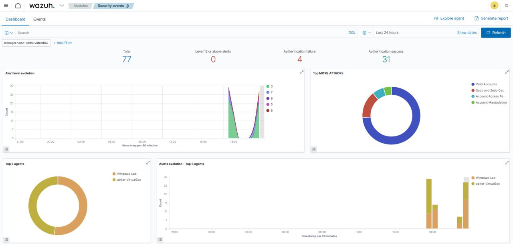
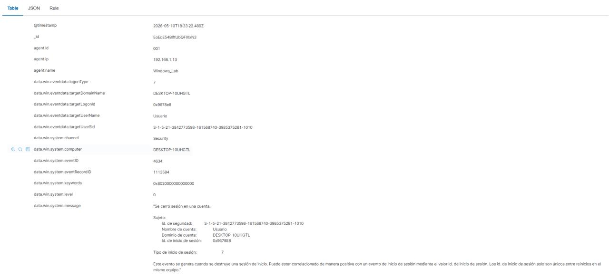
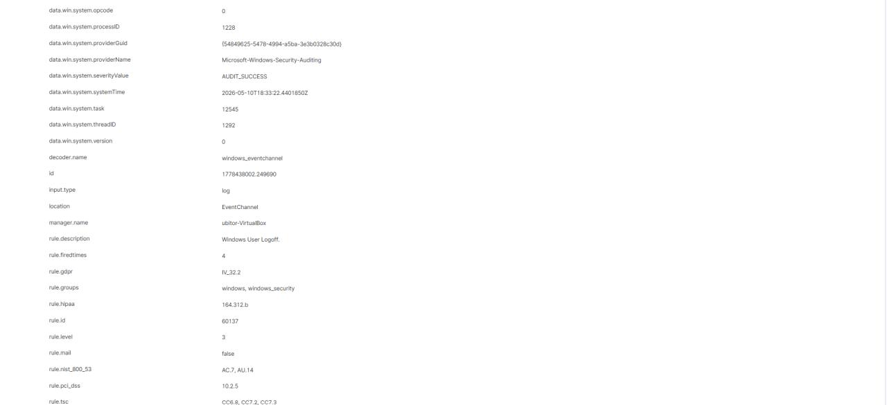

# 🚀 Análisis Forense y Triaje SOC: Monitorización de Eventos de Logoff (Event ID 4634) en Wazuh

Documentación técnica y análisis de triaje sobre el procesamiento de telemetría de Windows utilizando el SIEM Wazuh para la auditoría de cierres de sesión.

---

## 🔎 Resumen del Evento
* **Regla Wazuh:** `60137` (*"Windows User Logoff"*, Nivel 3 - Informativo).
* **Evento Windows:** Event ID `4634` (`AUDIT_SUCCESS`) en el canal *Security*.
* **Detalles del Host:** Cierre de sesión de la cuenta local `Usuario` en el agente `Windows_Lab` (`192.168.1.13`).
* **LogonType 7:** Cierre de sesión tras el desbloqueo o reconexión de estación de trabajo.

---

## ⚖️ Veredicto y Triaje SOC
* **Veredicto:** Falso positivo (Evento informativo de actividad benigna).
* **Severidad:** Baja.
* **Confianza:** 80%.
* **Decisión:** Evento clasificado como ruido operativo sin criterio de escalado a N2 (evento aislado en un solo host, usuario conocido, sin actividad sospechosa asociada).

---

## 🎯 Mapeo y Métricas del Dashboard
* **Volumen:** Auditoría de 77 alertas totales en 24h (0 alertas $\ge$ nivel 12).
* **Cumplimiento Normativo:** Cobertura alineada con marcos **NIST SP 800-53** (AC.7, AU.14), **GDPR**, **HIPAA** y **PCI DSS**.

---

## 📌 Conclusión
Procesos de análisis como este son fundamentales en la operativa diaria de un analista N1/SOC para filtrar el ruido de la red, validar la telemetría del sistema y optimizar la respuesta ante amenazas reales.
